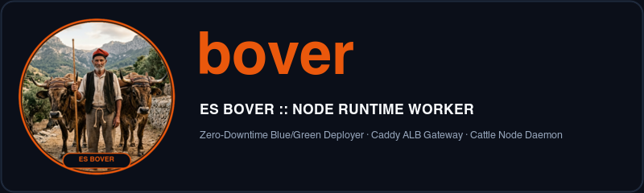

<p align="center">
  
  
</p>

<h1 align="center">lamo + bover — Zero-Dependency Multi-Server PaaS & VPS Hardening Suite</h1>

<p align="center">
  <a href=".github/workflows/ci.yml"></a>
  
  
  
  
</p>

Reproducible server provisioning, CIS-aligned kernel/SSH hardening, and zero-downtime Blue/Green multi-server orchestration for Linux infrastructure (**Debian 13 Trixie**). Provision and harden VPS nodes from scratch and manage containerized applications, TLS routing, encrypted secrets, and per-project cron jobs from your workstation without heavyweight third-party agents.

---

## Why `lamo` and `bover`? (The Mallorcan *Possessió* & "Servers as Cattle" Philosophy)

In modern cloud engineering, servers are treated as **cattle, not pets** (*ganado, no mascotas*): reproducible worker nodes managed centrally rather than hand-crafted snowflakes.

This project takes its names and visual identity from the traditional rural estates (**possessions**) of **Mallorca** in the 19th century:

| Archetype | Role in the Mallorcan *Possessió* | Role in this Platform |
| :---: | :--- | :--- |
| <br>**`lamo`**<br>*(L'Amo)* | **The Estate Overseer & Steward:** The trusted administrator who ran the entire *possessió*, planned the crops, kept the ledgers, and coordinated all field hands across the estate. | **Local Multi-Server Orchestrator CLI (`./lamo`):** Runs on your workstation. Maintains the fleet inventory (`nodes.json`), tracks SHA-256 provisioning state, opens multiplexed SSH tunnels, and dispatches commands across all your VPS nodes. |
| <br>**`bover`**<br>*(Es Bover)* | **The Oxen Driver & Cattle Herder (*Boyero*):** The tireless field worker who guided the yoked draft oxen (*bous*) with his staff (*agullada*) to plow the dry-stone terraces (*pedra en sec*) and haul the heavy loads. | **Server Cattle Daemon (`/usr/local/bin/bover`):** Runs as an isolated, unprivileged system worker on each VPS node. Pulls the heavy workload: builds Docker images, orchestrates zero-downtime Blue/Green switches, reloads Caddy in 0 ms, runs scheduled project crons, and ships encrypted backups. |

---

## 1. Multi-Server Architecture: `lamo` (Local) and `bover` (Server)

The platform is organized into two complementary components inspired by 19th-century Mallorcan agricultural archetypes:

```text
┌────────────────────────────────────────────────────────────────────────┐
│                      LOCAL WORKSTATION (macOS)                         │
│                                                                        │
│   CLI Orchestrator: ./lamo                                             │
│   (Inspired by L'Amo: The Estate Overseer and Administrator)           │
│   • Multi-Server Registry: manages cattle nodes (nodes.json)           │
│   • Replaces raw Make commands for daily operations                    │
│   • Transparent SSH Multiplexing with per-node sockets                 │
│   • SHA-256 state tracking and idempotency engine                      │
└───────────────────┬────────────────────────────────┬───────────────────┘
                    │                                │
    SSH (Node 1: node-1, port 2245)   SSH (Node 2: worker-2, port 2245)
                    │                                │
                    ▼                                ▼
┌──────────────────────────────────────┐  ┌──────────────────────────────┐
│       CATTLE NODE 1 (node-1)         │  │     CATTLE NODE 2 (worker-2) │
│                                      │  │                              │
│  Daemon: /usr/local/bin/bover        │  │  Daemon: /usr/local/bin/bover│
│  (Es Bover: The Oxen Driver & Worker)│  │  (Es Bover: The Oxen Driver) │
│  • Caddy Gateway ALB (TLS 1.2/1.3)   │  │  • Caddy Gateway ALB         │
│  • Blue/Green Zero-Downtime deployer │  │  • Blue/Green deployer       │
│  • Isolated Docker network routing   │  │  • Isolated Docker network   │
│  • Systemd persistence units         │  │  • Systemd persistence units │
│  • Dedicated per-node applications   │  │  • Dedicated per-node apps   │
└──────────────────────────────────────┘  └──────────────────────────────┘
```

* **`lamo` (Local Multi-Server Orchestrator):** Runs locally on your Mac (`./lamo <command>`). Reads your cattle node inventory (`nodes.json`), manages connections via multiplexed SSH sockets (`/tmp/ssh-mux-<uid>/<node>.sock`), targets specific servers (`-n <node>`), and orchestrates builds, deploys, and secrets.
* **`bover` (Server Cattle Daemon & Runtime Worker):** Installed at `/usr/local/bin/bover` on each server node. Handles local container workloads: builds images, manages Blue/Green slots with healthchecks, reloads Caddy in 0 ms, records SQLite metrics, and manages systemd boot persistence.

---

## 2. Security Philosophy and Hardening Decisions

### A. Dedicated Administrator User and Root Login Lockdown
* Direct `root` login via SSH is disabled (`PermitRootLogin no`).
* Only the configured administrator user (`ADMIN_USER`, default `admin` or as defined in `config.env`) is allowed to connect (`AllowUsers <ADMIN_USER>`).
* Passwordless `sudo` privileges are granted to this user for seamless automation.

### B. Custom SSH Port (2245)
* Changing the default SSH port removes 99.9% of automated Internet noise, brute-force bots, and port scanners.
* Drastically reduces CPU load and prevents `/var/log/auth.log` from growing excessively.
* **Debian 13 (Trixie)**: Utilizes *systemd socket activation* for SSH. Script `02-harden-ssh.sh` configures drop-in `/etc/systemd/system/ssh.socket.d/listen.conf` so port changes persist reliably across reboots and upgrades.

### C. Public Key Only Authentication
* Password and keyboard-interactive authentication are disabled (`PasswordAuthentication no`, `KbdInteractiveAuthentication no`).
* Brute-force attacks against SSH are completely mitigated.

### D. Repository Isolation with GitHub Deploy Keys
To prevent giving your entire GitHub account access to the server:
* `05-setup-deploy-keys.sh` and `lamo add` generate **independent ed25519 SSH keys per repository** (e.g. `id_deploy_app1`, `id_deploy_app2`).
* Each key is added to GitHub as a **Read-Only Deploy Key** specifically for that repository.
* If a server is ever compromised, the attacker has **zero access to your personal GitHub account**, other private repositories, or write permissions.
* Host aliases are configured in `~/.ssh/config` on the server so `git clone` automatically resolves the right key.

### E. System and Kernel Hardening
* **Sysctl:** IP spoofing protection (`rp_filter`), TCP SYN flood mitigation (`tcp_syncookies = 1`), and disabled ICMP redirect acceptance and source routing.
* **Fail2ban:** Monitors port 2245 and bans offending IPs after 3 failed attempts for 2 hours.
* **Unattended-upgrades:** Automatically applies Debian security patches daily.
* **Docker Log Rotation:** Enforces a 10 MB limit (maximum 3 files) per container to prevent Docker logs from exhausting server storage.

### F. Dedicated Unprivileged Daemon User (`bover`)
* All container management, deployments, and orchestrations run under an isolated system daemon user `bover` (`bover:bover`, home `/opt/apps`), member of the `docker` group.
* Administrator commands via SSH delegate directly to `sudo -u bover bover <args>`, completely eliminating root privilege execution for daily operations.
* Systemd service units (`bover-gateway`, `bover-app@`, `bover-metrics`, `bover-autodeploy`) run with `User=bover`, `Group=bover`, `ProtectSystem=strict`, `NoNewPrivileges=true`, `PrivateTmp=true`, and explicit read-write boundaries scoped only to `/opt/apps` and `/var/run/docker.sock`.
* Sudo privileges for `bover` are strictly scoped via `/etc/sudoers.d/92-bover-privileges` to control only `bover-app@*` units and invoke `/usr/local/bin/bover-helper`. Broad root permissions (`chown`, `chmod`, `useradd`) are eliminated.

### G. Per-App System User Isolation (UID 2001-2999)
* Following the principle of least privilege, each application runs under its own distinct, unprivileged Linux system user (`app_<name>`) with an allocated UID in the range 2001 to 2999.
* Application directories in `/opt/apps/<name>` are enforced with `0750` permissions, owned by `app_<name>:bover`.
* Containers run strictly with `user: "<uid>:<uid>"`, `security_opt: ["no-new-privileges:true"]`, and `pids_limit: 256`.
* Even in the event of an application exploit or container escape, the compromised process cannot access other applications' files, databases, or environment variables due to kernel-level file permissions.

### H. Host-Salted Encrypted Vault (`/opt/apps/.vault/`)
* Infrastructure secrets (such as Telegram bot tokens and alert credentials) are stored encrypted at rest in `/opt/apps/.vault/<name>.enc`.
* Encryption uses OpenSSL AES-256-CBC with PBKDF2 (100,000 iterations).
* The master key is dynamically derived using HMAC-SHA256 from the server's unique `/etc/machine-id` and a host-specific cryptographic salt (`/opt/apps/.vault/.salt`, mode `0400`).
* The vault directory `/opt/apps/.vault/` is restricted to mode `0700` owned exclusively by `bover:bover`.
* Secrets are never mounted into containers. If a server backup or disk snapshot is copied off-site, secrets cannot be decrypted without the host machine ID and local hardware salt.

### I. Comprehensive User Activity Auditing & Storage Boundaries
* **Session Command Auditing:** Every interactive shell command executed on the server is automatically intercepted and recorded via `/etc/profile.d/99-audit-commands.sh` to `/var/log/user-activity.log` and syslog (`authpriv.notice`), capturing timestamp, user, UID, tty, working directory, and exit code.
* **Sudo Audit Trail:** Sudo actions are logged to dedicated `/var/log/sudo.log` via `/etc/sudoers.d/90-sudo-audit`.
* **SSH Authentication Logging:** OpenSSH daemon is configured with `LogLevel VERBOSE` to record connection events and public key fingerprints.
* **Configurable Retention Policy:** Audit logs are rotated daily with a default 7-day retention (`USER_AUDIT_RETENTION_DAYS="7"`) to prevent disk exhaustion on resource-constrained servers.
* **Systemd Journal Boundaries:** Bound to a persistent storage cap (default: `JOURNALD_MAX_USE_MB="150"`, `MaxRetentionSec=7day`) in `/etc/systemd/journald.conf.d/99-retention.conf`.
* **Docker Container Log Boundaries:** The Docker daemon enforces hard rotation per container (default: `DOCKER_LOG_MAX_SIZE="10m"`, `DOCKER_LOG_MAX_FILES="3"`), capping container log storage at 30 MB per container.
* **Computational Resource Boundaries:** Applications are provisioned with default computational ceilings (`cpus: 0.5`, `mem_limit: 512m`) in `app.json`, fully configurable per application via CLI flags or JSON config.
* **Smart SSH Intrusion Alerts & Fingerprint Whitelisting:** With `ExposeAuthInfo yes`, `/etc/ssh/sshrc` inspects the connecting public key fingerprint. Authorized admin key logins run completely silent with zero alerts; unauthorized keys or rogue sessions immediately dispatch an encrypted Telegram alert. In parallel, Fail2ban notifies Telegram when an external attacker is banned after 3 failed attempts.
* **Out-of-band KVM / VNC Console Login Alerts:** Directly hooked into PAM (`/etc/pam.d/login`) via `pam_exec.so` (`/usr/local/bin/bover-console-alert`). Because direct hardware console logins bypass SSH entirely, any session opened via provider web VNC/KVM (such as Netcup CCP/SCP) triggers an immediate high-priority Telegram alert with the terminal (e.g. `tty1`) and authenticated user.

---

## 3. Project Structure

```text
.
├── .github/workflows/ci.yml          # GitHub Actions CI (syntax checks & unit test suite)
├── lamo                              # Local multi-server orchestrator CLI (macOS / Linux)
├── Makefile                          # Local development and test targets (make test, make clean)
├── README.md                         # Documentation and architecture reference
├── config.env.example                # Baseline node configuration template
├── nodes.json.example                # Multi-server cattle nodes registry template
├── inventory/                        # Local directory for real nodes & credentials (gitignored)
│   ├── config.env                    # Active baseline configuration & secrets (gitignored)
│   └── nodes.json                    # Active multi-server cattle registry (gitignored)
├── assets/                           # High-resolution branding suite (L'Amo & Es Bover)
│   ├── lamo-avatar.png               # 512x512 circular avatar for Telegram Bot
│   ├── lamo-logo.png                 # 800x240 slate header banner with typography
│   ├── lamo-favicon-64x64.png        # 64x64 rounded favicon for dashboards
│   ├── bover-avatar.png              # 512x512 circular avatar of Es Bover and draft oxen
│   ├── bover-logo.png                # 800x240 slate header banner for node worker
│   └── bover-favicon-64x64.png       # 64x64 rounded favicon for node worker
├── tests/                            # Automated unit test suite
│   ├── test_lamo.py                  # Tests for orchestrator, registry, and CLI routing
│   ├── test_bover.py                 # Tests for Caddyfile generation, state, and metrics
│   └── test_state.py                 # Tests for SHA-256 state tracking and idempotency
└── scripts/
    ├── 01-create-user.sh             # Creates admin user, sudoers, and authorized_keys
    ├── 02-harden-ssh.sh              # Configures port 2245, disables root and passwords
    ├── 03-harden-system.sh           # Sysctl tuning, fail2ban, unattended-upgrades
    ├── 04-install-docker.sh          # Official Docker CE and Compose plugin
    ├── 05-setup-deploy-keys.sh       # Generates isolated GitHub deploy keys
    ├── 06-custom-prompt-motd.sh      # Hostname, dynamic MOTD banner, and colored prompt
    ├── 07-tmux-vim-setup.sh          # Tmux vim-mode, infinite scroll, and Vim setup
    ├── 08-setup-app-user-and-docker-hardening.sh # Dedicated 'bover' daemon user and Docker daemon hardening
    ├── 09-cis-hardening.sh           # CIS Benchmark hardening suite (OS, SSH, Docker)
    ├── 10-setup-gateway-and-cli.sh   # Deploys Caddy ALB and installs 'bover' daemon
    ├── 11-setup-swap-and-memory.sh   # 2GB swapfile and vm.swappiness tuning
    ├── bover-cli.py                  # Source code for 'bover' server daemon
    ├── bover-helper.sh               # Scoped helper for per-app user and permission management
    ├── generate_branding.py          # Script generating image assets in assets/
    └── state.py                      # SHA-256 state and idempotency engine
```

---

## 4. Quick Start with `lamo`

### Step 1: Configure Primary Server
On your Mac, inside the project directory:

```bash
cp config.env.example config.env
nano config.env
```
Set your server public IP in `SERVER_IP="<SERVER_IP>"`.

### Step 2: Verify SSH Connectivity
```bash
./lamo ping
```

### Step 3: Inspect Provisioning State
Check SHA-256 checksums and module statuses:
```bash
./lamo status
```

Apply all pending or changed steps idempotently:
```bash
./lamo setup
```

### Step 4: Open Secure SSH Session
Connect directly without manually typing hostnames or ports:
```bash
./lamo ssh
```

---

## 5. State Management and Idempotency (`lamo status`)

The platform includes an automated idempotency engine based on SHA-256 checksums recorded remotely in `/etc/node-state.json`:

```bash
./lamo status
```

* **Step States:**
  * `✅ COMPLETED`: The step has been executed and the local script has not changed.
  * `⚠️  CHANGED`: The local script was modified and requires re-execution.
  * `⏳ PENDING`: The step has not yet been executed on the server.
* **Execution Options:**
  * `./lamo setup`: Executes **only** pending or changed steps, skipping up-to-date steps in milliseconds.
  * `./lamo apply --force`: Forces re-execution of all steps regardless of checksums.
  * `./lamo step <name>`: Runs an individual provisioning step (e.g. `./lamo step step-swap`).

---

## 6. Multi-Server and Cattle Node Management

`lamo` manages servers as cattle nodes. Each server maintains its own isolated applications, Docker network, and Caddy reverse proxy:

### A. Server Registry (`nodes.json` and `nodes.json.example`)
`config.env` provides global baseline defaults (such as default admin user, default hardened SSH port, SSH public key path, and swap size). The multi-server inventory lives in `nodes.json`, allowing each server to define its own IP, custom port, admin user, and initial bootstrap credentials:

```json
{
  "default": "node-1",
  "nodes": {
    "node-1": {
      "name": "node-1",
      "host": "192.0.2.10",
      "port": 2245,
      "user": "admin",
      "bootstrap_user": "root",
      "bootstrap_port": 22,
      "hostname": "node-1",
      "container_runtime": "docker",
      "notes": "Primary cattle server (Docker CE)"
    },
    "worker-2": {
      "name": "worker-2",
      "host": "198.51.100.25",
      "port": 2245,
      "user": "admin",
      "bootstrap_user": "root",
      "bootstrap_port": 22,
      "hostname": "worker-2",
      "container_runtime": "podman",
      "notes": "Secondary worker node (Podman)"
    }
  }
}
```

### B. Node Management Commands (`lamo node`)
* **List all cattle servers and check connectivity:**
  ```bash
  $ ./lamo node list    # or './lamo nodes'
  ==========================================================================================================
   ESTATE SERVERS & CATTLE NODES REGISTRY :: L'Amo Fleet
  ==========================================================================================================
  NODE             HOST:PORT                USER       RUNTIME    STATUS         APPS             ROLE
  ----------------------------------------------------------------------------------------------------------
  node-1 *         192.0.2.10:2245          admin      docker     ONLINE         1 apps           Default Node
  ----------------------------------------------------------------------------------------------------------
  * Default active node. Switch with 'lamo node use <name>' or target with '-n <name>'.
  ```

* **Inspect node provisioning state and checksums:**
  ```bash
  ./lamo node status
  ```

* **Inspect real-time host telemetry (CPU, RAM, Swap, Disk, Docker):**
  ```bash
  ./lamo node stats
  ```

* **List applications running on a specific node:**
  ```bash
  ./lamo node apps node-1
  ```

* **Register a new cattle node (CLI or interactive wizard):**
  ```bash
  # Interactive wizard (prompts for node name, host IP, runtime engine, and credentials)
  ./lamo node add

  # Or direct flag-based registration with custom runtime (docker or podman) and retention limits:
  ./lamo node add worker-2 198.51.100.25 --runtime podman --user admin --port 2245 --audit-retention-days 7 --journald-max-use-mb 150
  ```

* **Provision a newly registered node:**
  ```bash
  ./lamo -n worker-2 node setup
  ```

* **Switch the default active server:**
  ```bash
  ./lamo node use worker-2
  ```

* **Target a specific node for any command:**
  ```bash
  ./lamo -n node-1 app list
  ./lamo -n worker-2 app deploy myapp
  ./lamo -n worker-2 app disk
  ./lamo -n worker-2 app visits
  ./lamo -n worker-2 app logs myapp
  ./lamo -n worker-2 node ssh
  ```

---

## 7. Application Lifecycle Management (`lamo app` & `bover`)

The server runtime daemon `bover` (symlinked as `pages`, `lamo`, and `appctl`) acts as a lightweight, zero-dependency PaaS. Commands can be invoked with the namespaced syntax (`./lamo app <action>`) or legacy shorthand (`./lamo <action>`).

* **Fleet Inventory & Status:**
  ```bash
  ./lamo app list              # List applications across all cattle servers
  ./lamo app status myapp      # Container health, HTTP probe, IP, commit & traffic
  ./lamo app stats myapp       # CPU/RAM metrics & historical differential stats
  ./lamo app config myapp      # Routing, slots, build type & masked/unmasked secrets
  ```

### A. Interactive App Setup Wizard (`lamo add <repo>`)

To add any public or private repository:

```bash
./lamo add git@github.com:username/myapp.git
```

1. **Automatic Deploy Key Setup:** Generates a dedicated `ed25519` key and configures the host alias in `/opt/apps/.ssh/config`.
2. **Permission Guidance:** If GitHub rejects access (`Permission denied publickey`), `bover` displays the public key and direct settings URL (`https://github.com/owner/repo/settings/keys`).
3. **Stack and Port Detection:**
   * **Docker Compose:** Extracts exposed ports (`ports:` or `expose:`).
   * **Dockerfile:** Extracts `EXPOSE` directive.
   * **Go:** Detects `go.mod` (suggests port 8080).
   * **Node.js:** Detects `package.json` (suggests port 3000).
   * **Python:** Detects `pyproject.toml` or `requirements.txt` (suggests port 8000).
4. **Interactive Prompts:** Confirms domain, internal port, and Continuous Deployment toggle.
5. **Generates `app.json` and deploys immediately with zero downtime.**

### B. Declarative Service Definition (`app.json`)
Each application lives in `/opt/apps/<name>/` with an `app.json` file:

```json
{
  "name": "myapp",
  "domain": "app.example.com",
  "port": 8080,
  "repo": "git@github.com-myapp:username/myapp.git",
  "branch": "master",
  "healthcheck": "/",
  "healthcheck_timeout": 30,
  "auto_deploy": true,
  "keep_versions": 3
}
```

### C. Continuous Deployment via Git Polling
When `"auto_deploy": true` is enabled, the `bover-autodeploy.timer` systemd service checks GitHub every 60 seconds using `git ls-remote` (lightweight, under 1 second). When a new commit is detected on `master`, it executes an automated Blue/Green deployment without manual intervention.

### D. Zero-Downtime Blue/Green Deployment Strategy
When running `./lamo deploy <app>`:
1. **Git Sync:** Fetches latest commits with `git pull` using the isolated GitHub deploy key.
2. **Inactive Slot Target:** If the active slot is `blue`, it deploys to `green` (`<app>-green`), and vice versa.
3. **Build & Start:** Builds the Docker image and starts the container on the internal Docker network `gateway`.
4. **Automated Healthcheck:** Caddy probes the health endpoint (e.g. `http://<app>-green:8080/`) until receiving HTTP 200.
   - If healthcheck fails: the new container is safely stopped and removed. The live slot continues serving traffic untouched.
5. **Zero-Millisecond Caddy Reload:** Updates `/opt/apps/gateway/conf.d/<app>.caddy` and reloads Caddy in 0 ms.
6. **Connection Draining:** Waits 5 seconds for in-flight requests to complete before terminating the previous slot.

### E. Instant Rollback
```bash
./lamo rollback myapp
```
Immediately updates Caddy routing back to the previous slot and reloads configuration in 0 ms.

---

## 8. Enterprise Caddy ALB Gateway Endpoints

Caddy is configured with enterprise security standards:
* **Restricted TLS Versions:** Enforces **TLS 1.2 and TLS 1.3** exclusively (TLS 1.0 and 1.1 are disabled).
* **Modern AEAD Cipher Suites:** Elliptic curves (`x25519`, `secp256r1`) and AEAD ciphers (ECDHE-ECDSA/RSA with AES-GCM and ChaCha20-Poly1305). Weak ciphers (CBC, 3DES, RC4) are rejected.
* **Strict SNI and HTTP/3:** Configured with `strict_sni_host` and full support for HTTP/1.1, HTTP/2, and HTTP/3 (QUIC).
* **Total Server Fingerprint Removal:**
  * Strips the `Server` header (`-Server`) on both Caddy responses and upstream reverse proxy passes.
  * Strips technology disclosure headers (`-X-Powered-By`, `-X-AspNet-Version`, `-Via`), preventing attackers from identifying underlying frameworks.
* **Security Headers:** Automatic injection of HSTS (`max-age=31536000; includeSubDomains; preload`), `X-Content-Type-Options: nosniff`, `X-Frame-Options: SAMEORIGIN`, and `Referrer-Policy: strict-origin-when-cross-origin`.

---

## 9. Docker Image Retention and Pruning Lifecycle

To prevent old Docker layers and images from exhausting disk space over time, `bover` enforces an automated retention policy (`"keep_versions": 3` by default in `app.json`):
* After each build, the image is tagged immutably with its commit hash (`<app>:<commit>`) and slot.
* `bover` keeps exactly the latest `N` compiled versions, enabling instant rollback without rebuilding.
* Older images not currently in use by active containers are pruned automatically (`docker rmi`).
* Intermediary build layers are reclaimed with `docker image prune -f`.
* Manual cleanup can be triggered with `./lamo prune [app]`.

---

## 10. Deployment Audit History and Telegram Notifications

`bover` logs all deployment events to its SQLite database (`/opt/apps/stats.db`):
* Total deployment count and success rate per application.
* Commit hash and commit message deployed.
* Slot utilized (`blue` or `green`).
* Build and healthcheck duration in seconds.
* Exact error logs in case of failed deployment or rollback.

View deployment history:
```bash
./lamo history            # Global deployment history
./lamo history myapp      # History for a specific application
```

### Telegram Notifications
Configure alerts for successful deployments, failures, or preventive rollbacks:
```bash
./lamo telegram --token "<BOT_TOKEN>" --chat-id "<CHAT_ID>" --test
```

---

## 11. Storage Monitoring and Historical Differentials (`lamo disk`)

For storage-intensive applications with SQLite databases and persistent volumes:

* **Granular Breakdown:**
  * **Data / DB:** Database files (`.db`, `.sqlite`) and persistent files in `/opt/apps/<app>/data`.
  * **Code / Git:** Cloned repositories, Git objects, and build artifacts.
  * **Docker Images:** Actual disk footprint of active and retained Docker images.
* **Time Differentials:** Computes storage deltas relative to **1 hour, 24 hours, 7 days, and 30 days ago** using historical samples stored in SQLite.
* **Trend Analysis:** Identifies whether growth is stable (`STABLE`), growing (`GROWING (+X.X MB/d)`), or shrinking (`SHRINKING`).
* **Host Capacity:** Displays used and free capacity on the root partition (`/`).

```bash
./lamo disk               # Global disk usage across all apps
./lamo disk myapp         # Detailed breakdown for specific application
```

---

## 12. HTTP Traffic Analytics in Caddy (`lamo visits`)

Caddy logs incoming HTTP requests to JSON log files rotated per application (`/opt/apps/gateway/logs/<app>-access.log`). `bover` parses these logs in real time:

* **All-time total requests**.
* **Requests in the last 24 hours**.
* **Requests today**.
* **Unique visitors (unique IPs in 24 hours)**.
* **HTTP status code breakdown** (`2xx`, `4xx`, `5xx`).
* **Top requested endpoints and transferred bandwidth**.

```bash
./lamo visits             # Overview across all applications
./lamo visits myapp       # Detailed route analysis for specific application
```

---

## 13. Environment Variables and Secrets Hierarchy (`lamo env`)

To keep secrets secure and prevent applications from reading credentials from neighboring services:

1. **Shared Server Secrets (`/opt/apps/shared/.env`):**
   * Shared global variables across all apps on that server node (e.g. `TZ=Europe/Madrid`, `NODE_ENV=production`).
   * Permissions: `chmod 640` owned by `app:app`.
2. **Isolated App Secrets (`/opt/apps/<app>/.env`):**
   * App-specific secrets (e.g. `DATABASE_URL`, `JWT_SECRET`, API keys).
   * Permissions: `chmod 600` (readable only by the service owner).
   * **Real Container Isolation:** Each container runs in its own process and mount namespace. No container can mount or inspect files from `/opt/apps/<another_app>`. Application variables override shared variables on name collision.

```bash
./lamo env shared                                   # View shared variables
./lamo env myapp                                    # View merged variables for myapp
./lamo env myapp --set "JWT_SECRET=key" --set "W=4" # Set secrets
./lamo env myapp --unset "JWT_SECRET"               # Unset variable
```

---

## 14. Multiple Applications on the Same Internal Port

In Docker, two containers cannot bind the same host port (`ports: ["8080:8080"]`). In this platform:
* **Caddy is the only process listening on host ports 80 and 443.**
* All applications communicate exclusively through the internal Docker bridge network `gateway`.
* When deploying, `bover` generates an override with `ports: !reset []` and `expose: ["<port>"]`.
* Multiple applications can listen on the exact same internal port (e.g. `app1` on 8080 and `app2` on 8080) with zero collision. Caddy routes traffic using Docker DNS (`app1-blue:8080`, `app2-blue:8080`).

---

## 15. Safe Application Decommissioning (`lamo remove`)

To decommission an application cleanly without leaving orphaned containers, stale routing, or losing data:
1. Stops and removes active containers (`blue` and `green`).
2. Removes `/opt/apps/gateway/conf.d/<app>.caddy` and reloads Caddy in 0 ms.
3. Disables and removes `bover-app@<app>.service` in systemd.
4. Prunes Docker images associated with the app.
5. **Creates an automated backup archive** in `/opt/apps/backups/<app>-pre-decommission-<timestamp>.tar.gz` before deleting files.
6. Deletes `/opt/apps/<app>` (or preserves `/opt/apps/<app>/data` when `--keep-data` is supplied).
7. Sends a Telegram confirmation notification with the backup path.

```bash
./lamo remove myapp               # Interactive confirmation
./lamo remove myapp --force       # Non-interactive removal
./lamo remove myapp --keep-data   # Decommission but preserve data volume
```

---

## 15.B. Per-Project Cron Jobs & Execution Audit Registry (`lamo app cron`)

Each application can define scheduled tasks (`crons`) that are guaranteed to execute on time, isolated under the application's dedicated UID (`2001-2999`), with full SQLite execution history (`cron_executions`) and Telegram alerting.

### A. Execution Modes (`exec` vs `run`)
* **`exec` (Default):** Runs the command inside the currently active Blue/Green slot container (`docker exec -u <uid>:<uid> <app>-<slot> sh -c "<command>"`). Automatically follows slot switches during zero-downtime deployments.
* **`run` (Ephemeral Container):** Launches a clean, isolated ephemeral container (`docker run --rm`) using the app's deployed image, CPU/RAM limits, `.env` secrets, and persistent `/data` volume, removing the container immediately upon completion.

### B. Declarative Definition (`app.json` or repo `crons.json`)
You can define crons in `/opt/apps/<app>/app.json` or commit a `crons.json` (or `bover.json`) file in the root of your Git repository (automatically synchronized on every `lamo app deploy`):

```json
{
  "crons": [
    {
      "id": "daily-cleanup",
      "schedule": "0 3 * * *",
      "command": "python manage.py cleartokens",
      "mode": "exec",
      "timeout": 300,
      "enabled": true,
      "notify": "on_failure",
      "allow_overlap": false,
      "description": "Clean expired session tokens every night at 03:00"
    }
  ]
}
```

### C. Guaranteed Execution & Overlap Protection
* Driven by `bover-cron.timer` (systemd timer ticking every minute with `Persistent=true` and `AccuracySec=1s`).
* Tracks minute slots in SQLite (`cron_state`) with a 15-minute catch-up window: if a server is briefly busy or rebooting at the scheduled minute, `bover` catches up automatically (`triggered_by="catchup"`) and guarantees the task never double-fires within the same minute.
* Protects against overlapping runs per job via `flock` (`/opt/apps/<app>/.bover-cron-<id>.lock`) unless `--overlap` is enabled.

### D. CLI Management & Audit Inspection
```bash
# Add or update a cron job for an app
./lamo app cron add myapp daily-cleanup "0 3 * * *" "python manage.py cleartokens"
./lamo app cron add myapp heavy-report "@hourly" "python report.py" --mode run --timeout 600 --notify on_failure

# List all configured cron jobs and their last run status & duration
./lamo app cron list
./lamo app cron list myapp

# Trigger a cron job manually right now and stream its output
./lamo app cron run myapp daily-cleanup

# Pause / resume / remove a cron job
./lamo app cron disable myapp daily-cleanup
./lamo app cron enable myapp daily-cleanup
./lamo app cron remove myapp daily-cleanup

# Inspect execution audit history (status, exit code, duration in seconds, trigger)
./lamo app cron history
./lamo app cron history myapp --job daily-cleanup -n 20

# Inspect full metadata and captured stdout/stderr for a specific execution ID
./lamo app cron show 42
```

---

## 15.C. Automated Cloudflare R2 Backups & Integrity Verification (`lamo app backup`)

The platform includes a built-in automated backup and disaster recovery engine driven by `bover-backup.timer` (running daily at 03:00 UTC) with zero third-party pip dependencies:

### A. Non-Blocking Hot Backup & Pre-Flight Verification
* **Consistent Hot Copy:** For SQLite databases, `bover` leverages the native `sqlite3.backup` API, taking a consistent snapshot without stopping live containers or causing downtime.
* **Pre-Flight Integrity Gate:** Before packaging, `bover` runs `PRAGMA integrity_check` on the database replica. If corruption is detected, the upload is aborted immediately and an alert is dispatched to Telegram.
* **Complete State Packaging:** Includes persistent `/data` volumes, `app.json`, `.env` application secrets, server-wide `shared.env`, and a self-documenting `backup-metadata.json` manifest.
* **Ownership Self-Healing:** After every backup run, file ownership in `/opt/apps/<app>/data` is strictly reconciled to `app_<name>:bover` (mode `0770`/`0660`), preventing WAL/SHM file locking issues.

### B. Remote Cloudflare R2 / S3 Storage (AWS SigV4)
* Direct encrypted upload over HTTPS to Cloudflare R2 or Amazon S3 using pure standard-library AWS Signature Version 4.
* Credentials (`account_id`, `access_key`, `secret_key`, `bucket`) are stored in the host-salted vault (`/opt/apps/.vault/s3.json`, mode `0600`).

### C. Disaster Recovery & Deep Integrity Verification (`verify`)
You can inspect and verify any remote backup in a sandboxed temporary directory to guarantee that what was uploaded is genuine, uncorrupted, and 100% recoverable:

```bash
# List all remote backup archives stored in Cloudflare R2
./lamo app backup list
./lamo app backup list horify

# Download latest backup from R2 and perform deep sandbox verification
./lamo app backup verify horify
./lamo app backup verify workdoku

# Trigger immediate backup for one or all applications
./lamo app backup run horify
./lamo app backup all

# Configure Cloudflare R2 credentials
./lamo app backup config
```

What `verify` tests:
1. **Archive & Checksum:** Validates gzip stream integrity, decompression, and computes SHA-256.
2. **Configuration & Secrets:** Verifies `app.json` syntax and presence of `.env` secret keys.
3. **SQLite PRAGMA Integrity Check:** Connects to each extracted database and executes `PRAGMA integrity_check;` (ensuring `ok`).
4. **Relational Constraints:** Executes `PRAGMA foreign_key_check;` to verify relational consistency.
5. **Schema & Table Record Breakdown:** Queries `sqlite_master` and counts rows across all application tables.

### D. Local Rolling Retention & Disk Protection (`prune`)
To prevent backups from accumulating indefinitely and exhausting VPS disk space:
* **Off-Site vs Local Storage:** Cloudflare R2 retains the remote archives. A rolling copy of recent backups is kept on the VPS in `/opt/apps/backups/<app>/` for instant recovery without network round-trips.
* **Automatic Rotation (Default: 5 Days):** Every backup run automatically rotates the local archive folder, removing files older than 5 days (`keep_local_backups_days`).
* **Safety Lock:** The rotation engine guarantees that at least the most recent backup is always preserved on disk, even if all backups exceed the retention threshold.
* **On-Demand Pruning:** You can manually prune local backups across all apps or for a specific app:

```bash
# Rotate local backups for all applications retaining the last 5 days
./lamo app backup prune

# Rotate with a custom retention window (e.g. 3 days) for a specific app
./lamo app backup prune horify --days 3
```

---

## 16. Cinematic Visual Identity Suite (`assets/`)

The platform branding is based on 19th-century Mallorcan agricultural archetypes in the Serra de Tramuntana:

* **L'Amo (The Estate Administrator / Local Multi-Server CLI):**
  Represents estate stewardship, foresight, and high-level orchestration. Depicted walking through plowed terraced fields, wearing a wide-brimmed dark hat, white linen shirt, red sash (*faixa roja*), and shoulder bag, sowing seeds from a wicker basket with the historic stone *possessió* farmhouse in the background.
  * `assets/lamo-avatar.png` (512x512 px): Circular badge avatar with double gold border for Telegram Bot (`@BotFather`).
  * `assets/lamo-logo.png` (800x240 px): Slate banner with circular badge and modern typography.
  * `assets/lamo-favicon-64x64.png`: 64x64 rounded icon for browser dashboards.

* **Es Bover (The Oxen Driver / Server Cattle Daemon):**
  Represents steady, tireless labor and heavy runtime workloads. Depicted with his traditional red cap (*barretina*), rustic wool vest (*armilla*), rope-tied trousers, espadrilles, and long ox-goad staff (*agullada*), driving two draft oxen with a wooden yoke along dry-stone terraces (*pedra en sec*).
  * `assets/bover-avatar.png` (512x512 px): Circular badge avatar with bronze and amber border.
  * `assets/bover-logo.png` (800x240 px): Slate banner for server daemon documentation.
  * `assets/bover-favicon-64x64.png`: 64x64 rounded icon for node monitoring dashboards.

---

## 17. Automated Test Suite

The platform includes comprehensive automated unit tests covering all core components:

```bash
make test
```

### Test Coverage
* `tests/test_lamo.py`: Tests base configuration loading, cattle nodes registry initialization, active node resolution (default and explicit `-n`), node actions (`add`, `use`, `remove`), per-node SSH multiplexing socket paths, CLI argument parsing, and namespace normalization.
* `tests/test_bover.py`: Tests Caddyfile route generation (TLS 1.2/1.3 enforcement, security headers, Server fingerprint header removal), byte parsing and human-readable formatting, declarative `app.json` validation, state persistence, and SQLite database schema initialization.
* `tests/test_state.py`: Tests SHA-256 script checksum calculation, step status resolution (`COMPLETED`, `CHANGED`, `PENDING`), and idempotency predicates.

---

## 18. Command Quick Reference

```bash
# Multi-Server & Cattle Node Management
./lamo node list                 # List all cattle servers, connectivity status, and apps
./lamo node status               # Inspect node provisioning state and checksums
./lamo node stats                # Display host system telemetry (CPU, RAM, Disk, Docker)
./lamo node setup                # Execute pending or changed provisioning steps
./lamo node step <name>          # Execute a single step (e.g. step-swap)
./lamo node ping                 # Test SSH connectivity to target node
./lamo node ssh                  # Open interactive SSH session
./lamo node caddy status         # Inspect live Caddy reverse proxy health, ports & routing
./lamo node caddy stats          # Inspect Caddy CPU/RAM consumption and historical metrics
./lamo node caddy reload         # Hot-reload Caddy configuration with 0 downtime
./lamo node update               # Push latest 'bover' CLI binary to target node
./lamo node use <name>           # Switch default active server node
./lamo node add <name> <ip>      # Register a new cattle server node
./lamo -n <server> <command>     # Direct any command to a specific cattle server

# Application Lifecycle Management
./lamo app list                  # List active applications, domains, and health status
./lamo app status <app>          # Live container health check & HTTP probe
./lamo app stats <app>           # CPU/RAM metrics & historical differential stats
./lamo app config <app>          # Inspect app routing, slots and configuration
./lamo app deploy <app>          # Deploy app with git pull, build, and zero downtime
./lamo app rollback <app>        # Instant rollback to previous slot
./lamo app restart <app>         # Restart active slot with zero downtime
./lamo app logs <app> -f         # Stream live container logs
./lamo app disk                  # Display disk footprints and growth differentials
./lamo app visits                # Display Caddy HTTP requests and analytics
./lamo app env <app>             # Manage application secrets and environment variables
./lamo app history <app>         # View deployment and rollback audit history
./lamo app cron list [app]       # List per-project cron jobs, schedules & last status
./lamo app cron add <app> ...    # Add or update a scheduled cron job (exec or run mode)
./lamo app cron run <app> <id>   # Manually execute a cron job immediately
./lamo app cron history [app]    # View cron execution audit log, exit codes & durations
./lamo app cron show <run_id>    # View full captured stdout/stderr for a cron execution
./lamo app backup                # Run automated backup for all apps
./lamo app backup run <app>      # Trigger immediate backup for specific app(s)
./lamo app backup list [app]     # List remote backup archives stored in Cloudflare R2
./lamo app backup verify <app>   # Deep integrity test (SQLite PRAGMA, schema, secrets & files)
./lamo app backup prune [app]    # Rotate and prune local backups on disk (default: 5 days)
./lamo app backup config         # Configure Cloudflare R2 / S3 vault credentials
./lamo app prune                 # Enforce version retention lifecycle and prune old images
./lamo app autodeploy            # Poll remote git repos and auto-deploy new commits
./lamo app add <repo-url>        # Interactive wizard to clone and configure an app
./lamo app remove <app>          # Decommission and safely remove an application

# Alerts & Notifications
./lamo telegram configure        # Configure automated Telegram deployment alerts
./lamo telegram test             # Dispatch a test notification alert

# Local Development & Testing
make test                        # Run automated unit test suite (56 tests)
make clean                       # Clean bytecode, pycache and temporary files
```
